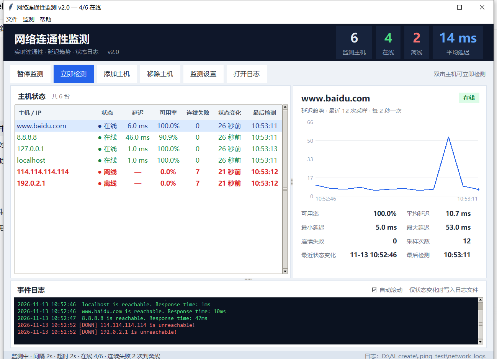

# 网络连通性监测工具 v2.0

实时监测服务器 / 网络设备的 ICMP 连通性与延迟：图形界面展示状态、延迟趋势和事件日志，
状态变化自动写入按日日志文件。适用于机房、办公网、家庭网络的长期值守。

> 本版本由 v1.2 命令行脚本重写而来，旧文件 `pingV1.2.py` 保留作参考。
> 新版入口为 `ping_monitor.py`，可直接运行源码，也可打包为单文件 exe。



## 主要功能

- **实时状态表格**：在线 / 离线 / 检测中、当前延迟、可用率、连续失败次数、状态变化时间、最后检测时间
- **单机延迟趋势**：最近 120 次采样折线图，失败采样在底部以红点标出
- **事件日志面板**：状态变化与系统事件实时显示，同时写入日志文件
- **参数持久化**：`config.json` 保存监测间隔、超时、并发数、判定阈值、日志保留天数等
- **列表热加载**：手工编辑 `server_list.txt` 后自动生效，无需重启程序
- **多目标并发**：每个目标独立线程，全局并发上限保护系统资源
- **多种地址**：支持 IPv4、IPv6（如 `::1`）、域名（如 `www.example.com`）
- **无界面模式**：`--headless` 适合服务器、计划任务或没有桌面的环境
- **单次自检**：`--once` 立即检测一轮并输出结果，便于排查

## 稳定性设计

- 每次 ping 都是独立子进程，并设置 `超时 + 5 秒` 的硬超时，进程卡死会被强制结束
- 目标线程内的任何异常都会被捕获，不会影响其他目标；线程退出后由看门狗自动重启
- 看门狗每 5 秒巡检；同一目标 60 秒内连续异常 5 次会退避 60 秒再试，避免疯狂重启
- 界面回调异常会弹窗提示并写入 `network_logs/crash.log`，程序继续运行
- 日志写入失败自动重试并限频提示；按日切分，可自动清理过期日志
- 配置文件和主机列表采用「临时文件 + 原子替换」写入，断电不会留下半截文件
- 默认单实例运行，避免两个进程同时写同一份日志（`--allow-multi` 可关闭）
- 趋势历史、界面日志行数均有上限，长期运行不会无限占用内存
- 启动时校验窗口位置，换显示器后不会把窗口丢到屏幕外

## 文件说明

| 文件 | 说明 |
| --- | --- |
| `ping_monitor.py` | 程序入口（GUI + 无界面） |
| `config.json` | 运行参数，首次运行自动生成 |
| `server_list.txt` | 监测主机列表，每行一个 IP / 域名，`#` 后为注释 |
| `network_logs/` | 按日日志目录，包含 `network_monitor_YYYY-MM-DD.txt` 和 `crash.log` |
| `build_exe.ps1` | 打包 Windows 单文件 exe 的脚本 |
| `pingV1.2.py` | 旧版命令行程序（保留参考） |

## 快速开始

### 1. 运行源码

```powershell
python ping_monitor.py
```

需要 Python 3.9+（使用 3.11 测试），仅依赖标准库（tkinter 需随 Python 安装）。

### 2. 配置要监测的主机

编辑 `server_list.txt`，每行一个地址：

```text
# 办公网
192.168.1.1
192.168.1.10

# 公网 DNS
8.8.8.8
www.baidu.com
::1
```

保存后程序会自动检测文件变化并更新列表；也可以点界面上的「添加主机」。

### 3. 打包 exe（可选）

```powershell
powershell -ExecutionPolicy Bypass -File .\build_exe.ps1
```

生成 `dist\ping_monitor.exe`，把 `server_list.txt` 放在 exe 同目录即可随身携带。
首次启动会在 exe 同目录生成 `config.json` 和 `network_logs/`。

### 4. 无界面运行

```powershell
python ping_monitor.py --headless
python ping_monitor.py --headless --duration 60   # 运行 60 秒后自动退出（自检）
```

无界面模式会在终端输出状态变化和每 10 秒一次的摘要，Ctrl+C 退出。
适合放到 Windows 计划任务或开机启动项中。

### 5. 单次检测

```powershell
python ping_monitor.py --once
```

输出每个目标的连通性和延迟，全部在线时退出码为 0，否则为 1，便于脚本判断。

打包后的 exe 是窗口程序，直接从命令行运行时标准输出不保证可见；如需获取结果码，
请用 `Start-Process` 等待进程结束：

```powershell
$p = Start-Process .\dist\ping_monitor.exe -ArgumentList '--once' -Wait -PassThru
$p.ExitCode
```

需要查看文字结果时，建议直接用源码运行 `python ping_monitor.py --once`。

## 界面使用

- **暂停 / 继续监测**：暂停后不再发起探测，恢复时会立即补测一轮
- **立即检测**：立刻对所有目标发起一轮探测；双击某一行只检测该主机
- **添加主机 / 移除主机**：修改列表并同步写回 `server_list.txt`
- **监测设置**：调整间隔、超时、并发上限、离线判定次数等，保存后立即生效
- **打开日志**：在资源管理器中打开日志目录
- **右键菜单**：立即检测、复制主机地址、移除该主机
- **快捷键**：`F5` 立即检测 · `Ctrl+R` 重载列表 · `Ctrl+P` 暂停/继续 · `Ctrl+Q` 退出 · `F1` 关于

状态说明：

| 显示 | 含义 |
| --- | --- |
| ● 在线 | 最近一次探测成功 |
| ◌ 检测中 | 已探测失败，但还没达到「连续失败判离线」次数 |
| ● 离线 | 连续失败次数达到阈值 |
| ○ 等待 | 尚未完成第一次探测 |

## 配置项

`config.json` 中可配置（界面「监测设置」会写回该文件）：

| 配置项 | 默认值 | 说明 |
| --- | --- | --- |
| `interval` | `5.0` | 每个目标的探测间隔（秒），1–3600 |
| `timeout` | `2.0` | 单次 ping 超时（秒），0.5–30 |
| `max_concurrent` | `16` | 同时运行的 ping 进程上限，1–64 |
| `fail_threshold` | `2` | 连续失败多少次判定为离线，1–10；设为 1 即恢复旧版行为 |
| `heartbeat_minutes` | `0` | 在线状态心跳写日志的间隔（分钟），0 表示只在状态变化时写 |
| `retain_days` | `30` | 日志保留天数，0 表示永久保留 |
| `history_size` | `120` | 趋势图保留的采样点数，10–2000 |
| `log_dir` | `network_logs` | 日志目录（相对程序目录） |
| `server_file` | `server_list.txt` | 主机列表文件（相对程序目录） |
| `window_geometry` | 空 | 上次退出时的窗口位置，自动保存 |

## 日志格式

文件：`network_logs/network_monitor_YYYY-MM-DD.txt`，UTF-8 编码，每天一个文件。

```text
2026-11-13 10:44:16 [INFO] 网络连通性监测 v2.0 启动（PID 10148）
2026-11-13 10:44:16 [INFO] 监测已启动：4 个目标 · 间隔 5s · 超时 2s · 连续失败 2 次判离线
2026-11-13 10:44:17  127.0.0.1 is reachable. Response time: 1ms
2026-11-13 10:44:22 [DOWN] nonexistent.invalid is unreachable!
2026-11-13 10:44:26 [INFO] 监测已停止
```

在线 / 离线两行沿用 v1.2 的格式，方便继续用现有脚本分析；
`[INFO]` / `[WARN]` / `[ERROR]` 为系统事件。
未处理异常会额外写入 `network_logs/crash.log`（超过 2MB 自动轮转一次）。

## 命令行参数

| 参数 | 说明 |
| --- | --- |
| `--headless` | 无图形界面运行 |
| `--once` | 只检测一轮，打印结果后退出 |
| `--duration SECONDS` | 无界面模式运行指定秒数后退出 |
| `--config PATH` | 指定配置文件（默认程序目录下 `config.json`） |
| `--allow-multi` | 允许同时运行多个实例 |
| `--version` | 显示版本 |
| `-h, --help` | 查看帮助 |

## 常见问题

**双击后没有窗口？**
如果用的是 `python` 而非 `pythonw`，会带一个控制台窗口；打包后的 exe 使用 `--windowed`，不会显示控制台。
若窗口被其他窗口挡住，可从任务栏切换；程序默认只允许运行一个实例。

**双击 exe 后杀毒软件报毒？**
PyInstaller 单文件程序自解压到临时目录，容易被启发式规则误报。可以添加信任，
或修改 `build_exe.ps1` 去掉 `--onefile`（改成目录形式）重新打包。

**中文日志会乱码吗？**
日志固定 UTF-8 写入；Windows 记事本、VS Code、`Get-Content -Encoding utf8` 均可正常显示。
ping 命令本身的输出会按系统代码页自动解码，中文 / 英文系统都能正确识别超时、无法访问等状态。

**没有图形界面（如 Windows Server Core）怎么办？**
使用 `--headless`；程序会在检测不到 tkinter 时自动切换到无界面模式。

**修改 `server_list.txt` 后要重启吗？**
不需要，运行中每 2 秒检查一次文件修改时间，变更后自动生效。
通过界面添加 / 移除主机时，程序会重写该文件（自动生成文件头，原有行内注释可能丢失）。

## 开发与自检

```powershell
python -m py_compile ping_monitor.py   # 语法检查
python ping_monitor.py --once          # 探测逻辑自检
python ping_monitor.py --headless --duration 15   # 无界面稳定性自检
```

## 版本变更

### v2.0
- 新增 tkinter 图形界面：状态表格、延迟趋势、事件日志、汇总卡片
- 新增 `config.json` 持久化与界面设置
- 每个目标独立线程 + 全局并发上限，替代固定 `sleep` 轮询
- ping 子进程硬超时、线程看门狗、崩溃日志、GUI 异常兜底
- 支持域名与 IPv6，兼容中英文系统 ping 输出
- 支持主机列表热加载、单实例运行、日志自动清理
- 新增 `--headless`、`--once`、`--duration`、`--config` 等命令行参数

### v1.2
- 命令行多线程 ping，状态变化写入日志
